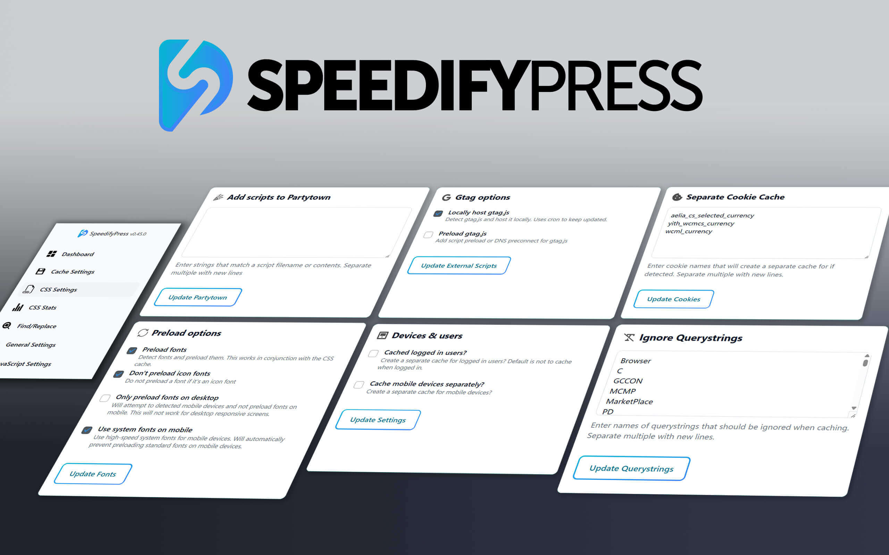

# SpeedifyPress - Real-World WP Speed, Engineered for Pros

SpeedifyPress is a performance optimization toolkit for WordPress, built for developers and agencies who need real-world speed and precision control. Combining advanced techniques with practical configurability, SpeedifyPress goes beyond typical plugins to deliver fast, scalable, and reliable results — all without compromising compatibility or flexibility. From smart unused CSS handling to Cloudflare-ready caching, it's your personal speed stack, engineered for you.


# 🔑 Key Capabilities

### Community Edition (this repository)

- **Unused CSS Handling (Done Right)**  
  Smart removal of unused CSS with a custom approach that avoids common pitfalls of other solutions.

- **CSS Statistics**  
  Review CSS usage and savings by page path, plugin and post type.

- **Advanced Page Caching**  
  Cache pages with full support for language/currency plugins

- **JavaScript Delay**  
  Delay JavaScript for better performance — with fine-tuned control for real-world use cases. You'll get this working for all sites. 

- **Local Google Analytics (gtag.js)**  
  Serve Google Analytics locally for faster load times and better privacy.

- **Image Lazyloading + Preload**  
  Lazyload images with a custom preloader and automatically preload your LCP image for faster perceived load.

- **HTML Lazyloading**  
  Defer rendering of below-the-fold HTML for a faster initial paint.
  
- **Expert Font Loading**  
  Automatically preload the right fonts and fall back to fast system fonts on mobile where appropriate.

- **Remove Bloat**  
  Quick and easy removal of all of WordPress' mostly bloaty features

### WordPress Edition (buildable from this repository)

The WordPress.org edition, **SpeedifyCSS**, focuses on CSS optimization and optional page caching:

- **Unused CSS Handling**  
  Generate page-specific stylesheets with unused CSS removed.

- **Page Caching**  
  Optionally cache generated pages alongside their optimized CSS.

- **CSS Statistics**  
  Review CSS usage and savings by page path, plugin and post type.

It does not include the Community edition's JavaScript delay, image and HTML lazyloading,
font-delivery optimizations, local analytics or bloat-removal features. No email registration
or license key is required.

The admin source and build commands for both editions are included here; see the build
instructions below. Building WordPress admin assets does not convert the Community PHP
plugin into the SpeedifyCSS release.

### Pro Edition ([https://speedifypress.com/go-pro](https://speedifypress.com/go-pro))

The Pro Edition includes all the features of the Community Edition, plus:

- **Cloudflare Integration**  
  Use a custom Cloudflare Worker for intelligent, edge-level caching — with an easy way to clear the cache.

- **Cache All of WooCommerce**  
  Cache WooCommerce without worrying about nonces and hardcoded user info. Even works on the cart and checkout pages. 

- **Cache Logged In Users**  
  The cache works even for logged in users with dynamic information on the page. Yes, really. 

- **HTML Find/Replace**  
  Modify your site's HTML on-the-fly with advanced find/replace rules — ideal for agency or power users.  

- **Code Insertion**  
  Add custom code to the page head or body without editing your theme.

- **AJAX Nonce Replacement**  
  Help supported AJAX requests keep working when cached pages contain expired WordPress nonces. Not limited to WooCommerce.

- **Partytown Integration (Beta)**  
  Run selected third-party scripts in web workers to reduce work on the browser's main thread.

- **Advanced JavaScript Controls**  
  Defer scripts, force selected scripts inline and configure the completion events fired after delayed JavaScript loads.

- **Device-Specific CSS and Caching**  
  Choose mobile, tablet and desktop CSS generation resolutions, and optionally cache mobile pages separately.

- **Fine-Grained Font Controls**  
  Configure font preloading, desktop-only preloads, icon-font exclusions and the list of known icon fonts.

- **Additional Performance and Security Controls**  
  Preload locally hosted Analytics, force gzip output, enable Turnstile protection and adjust CSRF expiry and CSS force-include limits.

- **Unlimited Sites and Personal Support**  
  Use your Pro license across unlimited sites and get personal support by email.


## ⚡ Quick Start

1. **Download SpeedifyPress**  
   Simply download the zip from this repository or from [https://speedifypress.com/license/free/](https://speedifypress.com/license/free/)

2. **Install the Plugin on Your WordPress Site**  
   - Log in to your WordPress dashboard  
   - Go to **Plugins → Add New → Upload Plugin**  
   - Upload the `.zip` file and click **Install Now**  
   - Activate the plugin

3. **Access the Dashboard and Register**  
   Once the installation is finished, click "I need a license" in the Dashboard. For single sites, we'll email you a free license. 

4. **Subscribe to the Newsletter**  
   Subscribe for free at the [Adventures in WordPressing Substack](https://adventuresinwordpressing.substack.com/p/speedifypress) to find out how we're using the plugin on real sites. 

5. **Enjoy the Speed**  
   Your site is now equipped with professional-grade optimization tools — faster load times, improved performance scores, and happier users.

## Building the Admin Interface

The repository includes the Vue admin source for the Community and WordPress editions
in `admin_app`.

Use Node.js 22 or newer with npm. Run these commands as your normal user, not with `sudo`:

```sh
cd admin_app
npm ci
```

`npm ci` installs the dependency versions recorded in `package-lock.json`, including Vite.
Run it before your first build and again when the lockfile changes.

### Community Edition

From `admin_app`, rebuild the Community admin interface:

```sh
npm run build:community
# Or rebuild automatically while editing:
npm run watch:community
```

### WordPress Edition (SpeedifyCSS)

From `admin_app`, rebuild the CSS, Cache and CSS Stats admin interface used by SpeedifyCSS:

```sh
npm run build:wordpressorg
# Or rebuild automatically while editing:
npm run watch:wordpressorg
```

This target builds the WordPress edition's admin assets only; it does not convert the
Community PHP plugin into a SpeedifyCSS release.

### Build Output

Edit the Vue components in `admin_app/src`. Both targets write compiled files back into
the plugin's `assets` directory, including `assets/admin/admin.min.js` and
`assets/admin/admin.min.css`. They overwrite the same files, so run
`npm run build:community` to switch back to the Community interface. Clear your browser
cache if the admin still shows an older build.

The Community workspace does not include release-packaging commands or scripts.
Builds do not create ZIP files or replace another plugin directory. PHP changes do not
need an npm build; rebuild after changing Vue, CSS or JavaScript source files.

## 📝 Documentation & Support

Full documentation and support info is available [here](https://github.com/SpeedifyPress/SpeedifyPress/blob/main/SUPPORT.md).
## 📸 Screenshots

  <p>
    <a href='https://speedifypress.com/go-pro' target='_blank'>
            
    </a>
  </p>
  <p>
    <a href='https://speedifypress.com/go-pro' target='_blank'>
        
    </a>
  </p>
  <p>
    <a href='https://speedifypress.com/go-pro' target='_blank'>
        
    </a>
  </p>
  <p>
    <a href='https://speedifypress.com/go-pro' target='_blank'>    
        
    </a>
  </p>
  <p>
    <a href='https://speedifypress.com/go-pro' target='_blank'>    
        
    </a>
  </p>
  
## 📝 License

SpeedifyPress is licensed under the **GNU General Public License v3.0 or later (GPL)**.  
You are free to use, study, modify, and redistribute the source code under the terms of the GPL.

### Community and WordPress Editions

The WordPress Edition does not require email registration or a license key.

The Community Edition uses a free subscription requiring an email address, so we can
contact you with essential version and security information.

Of course, you're free to modify the code if you'd prefer not to use a subscription.

### Pro Edition

A paid subscription unlocks:

- Access to all the plugin features including the Cloudflare integration and logged-in caching
- An unlimited site license
- Personal installation and configuration support  
- Find out more at [https://speedifypress.com/go-pro](https://speedifypress.com/go-pro)

> ⚠️ While the GPL allows code redistribution and modification, unlocking features requires a valid subscription.  
> The locking mechanism is designed to encourage support and continued development, but it does not restrict your legal rights under the GPL.
